<div align="center">


</div>


<div align="center">

### ☁️ About Me

</div>



I'm a **4th-year Software Engineering student at Mae Fah Luang University (MFU)** in Chiang Rai, Thailand. I like taking an idea all the way through: sketching the screens in Figma, writing the app, wiring up the API and testing it until it holds together. I'm self-motivated and always picking up something new, from mobile frameworks to game engines.

- 🎓 **Studying:** Software Engineering at MFU, now in my final year
- 🌐 **Web & backend:** building with React, Node.js and NestJS, and testing APIs in Postman
- 📱 **Mobile:** shipped a React Native app with Expo and worked in a team on a Flutter app
- 🎮 **Games:** made a Monster Hunter companion app and I'm exploring Unity with C# and C++
- 🔐 **Security:** practising secure coding against the OWASP Top 10 in hands-on labs
- 🌱 **Right now:** sharpening my backend skills and looking for projects to learn from
- 📫 **Reach me:** [qssomme@gmail.com](mailto:qssomme@gmail.com)

<br clear="right" />



```ts
const phuriphat: Developer = {
  name: "Phuriphat Chantiuaong",
  university: "Mae Fah Luang University (MFU)",
  major: "Software Engineering",
  year: 4,
  location: "Chiang Rai, Thailand",
  languages: ["JavaScript", "TypeScript", "Python", "Java", "C#", "C++", "Dart"],
  stack: {
    web: ["React", "Node.js", "NestJS"],
    mobile: ["React Native", "Expo", "Flutter"],
    gameDev: ["Unity"],
    design: ["Figma"],
  },
  tools: ["Git", "GitHub", "GitLab", "VS Code", "Postman", "Docker"],
  traits: ["self-motivated", "continuous learner"],
  currentQuest: () => "Graduate and ship things people actually use",
};
```


<div align="center">

### 🧙 Character Sheet



</div>


<div align="center">

### 📜 Quest Log


</div>


<div align="center">

### 🤝 Connect

*Send a message to my guild hall*

<a href="https://github.com/Phuriphat555"></a>
<a href="mailto:qssomme@gmail.com"></a>

</div>


<div align="center">

### 🎒 Tech Stack · Inventory


</div>


<div align="center">

### 📂 Featured Projects

<a href="https://github.com/Phuriphat555/Final-Exam"></a>
<a href="https://github.com/Phuriphat555/Challenge-Goal-App"></a>
<a href="https://github.com/Phuriphat555/software-security"></a>

</div>


<div align="center">

### 📊 GitHub Stats


<picture>
  <source media="(prefers-color-scheme: dark)" srcset="https://raw.githubusercontent.com/Phuriphat555/Phuriphat555/output/activity-dark.svg" />
  <source media="(prefers-color-scheme: light)" srcset="https://raw.githubusercontent.com/Phuriphat555/Phuriphat555/output/activity.svg" />
  
</picture>

</div>


<div align="center">

### ⚔️ Contribution Quest

Every day I code spawns a slime. My knight slays them for EXP and levels up.

<picture>
  <source media="(prefers-color-scheme: dark)" srcset="https://raw.githubusercontent.com/Phuriphat555/Phuriphat555/output/mmorpg-contribution-dark.svg" />
  <source media="(prefers-color-scheme: light)" srcset="https://raw.githubusercontent.com/Phuriphat555/Phuriphat555/output/mmorpg-contribution.svg" />
  
</picture>

</div>


<div align="center">


</div>
