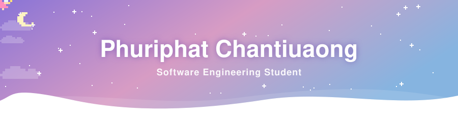
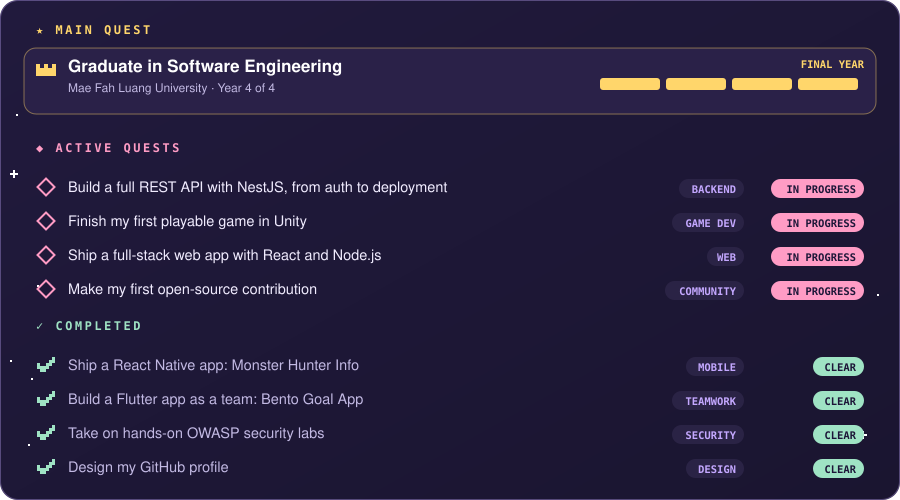
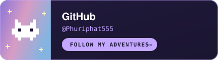
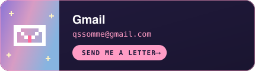
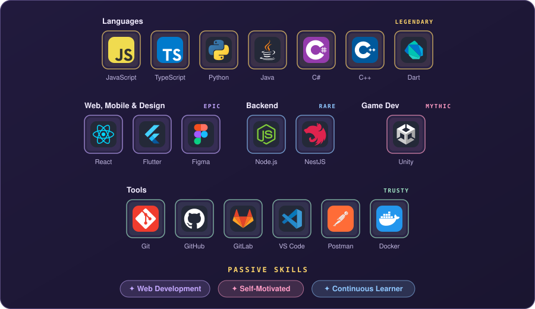
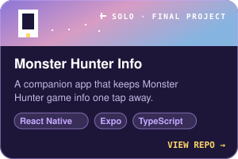
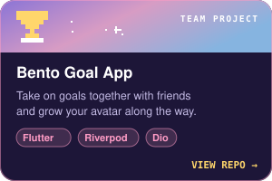
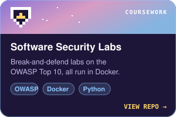
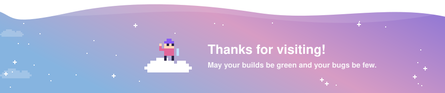

### ☁️ About Me

### 🧙 Character Sheet · Skill Levels

### 📜 Quest Log

### 🤝 Connect

*Send a message to my guild hall*

### 🎒 Tech Stack · Inventory

### 📂 Featured Projects

### 📊 Adventurer Stats

<picture>
  <source media="(prefers-color-scheme: dark)" srcset="https://raw.githubusercontent.com/Phuriphat555/Phuriphat555/output/activity-dark.svg" />
  <source media="(prefers-color-scheme: light)" srcset="https://raw.githubusercontent.com/Phuriphat555/Phuriphat555/output/activity.svg" />
  
</picture>

### ⚔️ Contribution Quest

Every day I code spawns a slime. My knight slays them for EXP and levels up.

<picture>
  <source media="(prefers-color-scheme: dark)" srcset="https://raw.githubusercontent.com/Phuriphat555/Phuriphat555/output/mmorpg-contribution-dark.svg" />
  <source media="(prefers-color-scheme: light)" srcset="https://raw.githubusercontent.com/Phuriphat555/Phuriphat555/output/mmorpg-contribution.svg" />
  
</picture>

